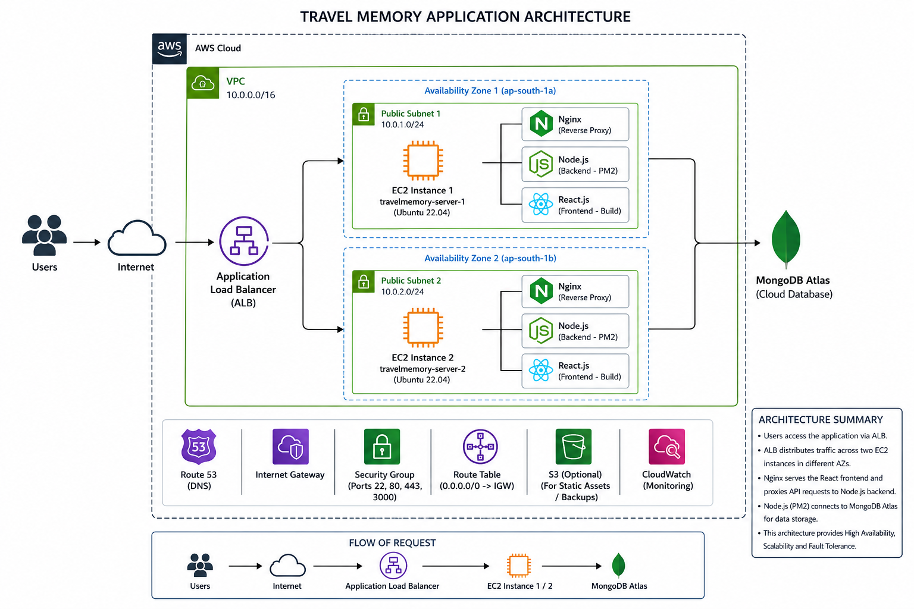

#Architecture 


# Step 1: Create VPC

## Description

Created a Virtual Private Cloud (VPC) to isolate and manage AWS networking resources.

### Configuration

* VPC Name: `travelmemory-vpc`
* IPv4 CIDR Block: `10.0.0.0/16`
* Tenancy: Default

### Screenshot

---

# Step 2: Create Internet Gateway

## Description

Created an Internet Gateway and attached it to the VPC to allow internet access.

### Configuration

* Internet Gateway Name: `travelmemory-igw`
* Attached VPC: `travelmemory-vpc`

### Screenshot

---

# Step 3: Create Public Subnets

## Description

Created two public subnets in different Availability Zones for high availability.

### Configuration

#### Public Subnet 1

* Name: `public-subnet-1`
* Availability Zone: `ap-south-1a`
* CIDR: `10.0.1.0/24`

#### Public Subnet 2

* Name: `public-subnet-2`
* Availability Zone: `ap-south-1b`
* CIDR: `10.0.2.0/24`

### Screenshot
 

---

# Step 4: Create Route Table

## Description

Created a public route table and configured internet access.

### Configuration

| Destination | Target           |
| ----------- | ---------------- |
| 0.0.0.0/0   | Internet Gateway |

Associated Subnets:

* public-subnet-1
* public-subnet-2

### Screenshot

---

# Step 5: Create Security Group

## Description

Created a security group to allow application traffic.

### Inbound Rules

| Type       | Port | Source   |
| ---------- | ---- | -------- |
| SSH        | 22   | My IP    |
| HTTP       | 80   | Anywhere |
| HTTPS      | 443  | Anywhere |
| Custom TCP | 3000 | Anywhere |

### Screenshot

---

# Step 6: Launch EC2 Instances

## Description

Created two Ubuntu EC2 instances for application deployment and load balancing.

### Configuration

* Operating System: Ubuntu 22.04 LTS
* Instance Type: t2.micro
* Number of Instances: 2
* Storage: 20 GB
* Public IP: Enabled

### Instances

#### Instance 1

* Name: travelmemory-server-1

#### Instance 2

* Name: travelmemory-server-2

### Screenshot

---

# Step 7: Connect to EC2

## SSH Command

```bash
ssh -i travelmemory-key.pem ubuntu@PUBLIC_IP
```

### Screenshot


---

# Step 8: Install Required Software

## Update Server

```bash
sudo apt update
sudo apt upgrade -y
```

## Install Git

```bash
sudo apt install git -y
```

## Install Node.js

```bash
curl -fsSL https://deb.nodesource.com/setup_20.x | sudo -E bash -
sudo apt install nodejs -y
```

## Install Nginx

```bash
sudo apt install nginx -y
sudo systemctl enable nginx
sudo systemctl start nginx
```

## Install PM2

```bash
sudo npm install pm2 -g
```

### Screenshot


---

# Step 9: Clone Application Repository

```bash
git clone https://github.com/UnpredictablePrashant/TravelMemory.git
cd TravelMemory
```

### Screenshot

---

# Step 10: Backend Deployment

## Navigate to Backend

```bash
cd backend
npm install
```

## Configure Environment Variables

Create `.env`

```env
PORT=3000
MONGO_URI=<mongodb_connection_string>
JWT_SECRET=<secret_key>
```

## Start Backend

```bash
pm2 start index.js --name backend
pm2 save
pm2 startup
```

### Screenshot


---

# Step 11: Frontend Deployment

## Navigate to Frontend

```bash
cd frontend
npm install
npm run build
```

## Copy Build Files

```bash
sudo mkdir -p /var/www/travelmemory
sudo cp -r build/* /var/www/travelmemory/
```

### Screenshot

---

# Step 12: Configure Nginx Reverse Proxy

## Configuration

```nginx
server {
    listen 80 default_server ;
    server_name _;

    root /var/www/travelmemory;
    index index.html;

    location / {
        try_files $uri /index.html;
    }

    location /api {
        proxy_pass http://localhost:3000;

        proxy_http_version 1.1;
        proxy_set_header Upgrade $http_upgrade;
        proxy_set_header Connection "upgrade";
        proxy_set_header Host $host;
    }
}
```

## Restart Nginx

```bash
sudo nginx -t
sudo systemctl restart nginx
```

### Screenshot


---

# Step 13: Create Target Group

## Configuration

* Target Type: Instances
* Protocol: HTTP
* Port: 80
* Health Check Path: /

Added Targets:

* travelmemory-server-1
* travelmemory-server-2

### Screenshot


---

# Step 14: Create Application Load Balancer

## Configuration

* Load Balancer Type: Application Load Balancer
* Scheme: Internet Facing
* Listener: HTTP (80)
* Availability Zones:

  * public-subnet-1
  * public-subnet-2

### Screenshot

---

# Step 15: Configure Cloudflare DNS

I don't have domain so i have skipped this

---

# Step 16: Final Testing

## Verify

* Frontend loads successfully
* Backend APIs are reachable
* Custom domain is accessible
* Application is load balanced between both EC2 instances

### Screenshot

---

#
